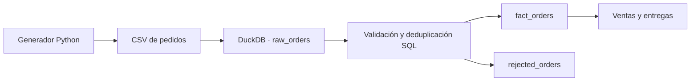

# Portafolio de Ingeniería de Datos

Soy Gonzalo Gómez. Aquí reúno un proyecto de procesamiento por lotes y dos prácticas de streaming desarrolladas durante mi formación en Ingeniería de Datos.

| Proyecto | Qué puedes revisar | Herramientas |
| --- | --- | --- |
| [Retail Data Pipeline](#retail-data-pipeline) | Generación de pedidos sintéticos, validación, deduplicación y métricas de ventas y entregas. | Python, DuckDB, SQL |
| [Sesión 11 · Kafka con Redpanda](redpanda-python/README.md#clase-11--redpanda-con-python) | Creación de un topic, publicación de mensajes y lectura por partición y offset. | Python, Kafka, Redpanda |
| [Sesión 12 · Streaming de vuelos](redpanda-python/README.md#sesión-12--aviationstack--redpanda) | Consulta de vuelos en Aviationstack y publicación en Redpanda, verificada desde Colab. Incluye un consumidor MySQL y un notebook de Spark para S3. | Aviationstack, Python, Redpanda, MySQL, Spark, S3 |

## Retail Data Pipeline

Pipeline de ingeniería de datos para un e-commerce ficticio. Genera pedidos sintéticos, registra los motivos de rechazo y calcula ventas y puntualidad de entregas con Python y DuckDB SQL. Todos los montos se expresan en soles peruanos (PEN).



### Ejecutar en Windows

Desde la raíz del repositorio, con Python 3.12 disponible en PowerShell:

```powershell
python -m venv "$env:LOCALAPPDATA/retail-pipeline-venv"
$retailPython = "$env:LOCALAPPDATA/retail-pipeline-venv/Scripts/python.exe"
& $retailPython -m pip install -r requirements.txt
& $retailPython pipeline.py --orders 1000 --seed 42 --output "$env:LOCALAPPDATA/retail-pipeline-data"
& $retailPython -m unittest -v
```

La ubicación de salida del ejemplo mantiene el CSV y la base fuera de OneDrive. Si omites `--output`, la salida se guarda en `.data`, excluida de Git. Usa una carpeta de salida distinta para cada ejecución simultánea.

### Datos y resultados

El grano es un registro por pedido válido. El generador cubre 180 días desde el 1 de enero de 2025 y recrea los mismos pedidos con la misma semilla. Cada 20 pedidos incorpora una copia exacta y cada 25 introduce un registro adicional sin cantidad. Con 1.000 pedidos, el resultado esperado es 1.090 filas de entrada, 1.000 aceptadas, 50 duplicadas y 40 rechazadas por cantidad inválida.

| Objeto | Contenido |
| --- | --- |
| `raw_orders` | Filas originales del CSV |
| `fact_orders` | Pedidos válidos con identificador único y monto calculado |
| `rejected_orders` | Filas originales rechazadas y su primer motivo de rechazo |
| `quality_summary` | Conteo por motivo o aceptación |
| `monthly_kpis` | Pedidos, ventas entregadas y porcentaje de entregas puntuales |
| `monthly_category_sales` | Ventas entregadas por mes y categoría |

El mes corresponde a la fecha del pedido. Las ventas se calculan sobre pedidos entregados. Una entrega es puntual si ocurre en la fecha prometida o antes. Cuando el mes no tiene entregas, su porcentaje de puntualidad es nulo.

Puedes abrir `retail.duckdb` con DuckDB y ejecutar estas consultas:

```sql
SELECT * FROM quality_summary ORDER BY result;
SELECT * FROM monthly_kpis ORDER BY month;
SELECT * FROM monthly_category_sales ORDER BY month, delivered_sales_pen DESC;
```

GitHub Actions ejecuta las pruebas de reconciliación, repetibilidad y cálculo de métricas en cada push y pull request.
