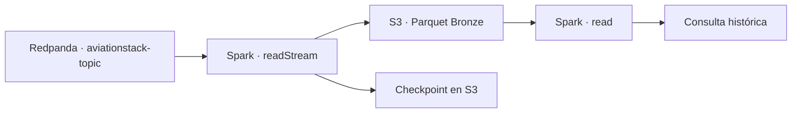

# Clase 11 · Redpanda con Python

El topic almacena eventos. El productor envía 100 mensajes y el consumidor muestra cada mensaje junto con su partición y su offset, que es su posición dentro de la partición.

## Preparación en PowerShell

Desde la raíz del proyecto en Visual Studio Code, ejecuta estos comandos. Puedes usar directamente el Python del entorno virtual sin activar el entorno.

```powershell
cd .\redpanda-python
python -m venv venv
.\venv\Scripts\python.exe -m pip install -r requirements.txt
if (-not (Test-Path .env)) { Copy-Item .env.example .env }
```

Pídele al profesor el servidor Kafka, el mecanismo SASL, el usuario, la contraseña y el topic asignado. Completa `.env` con esos datos. Para el ejercicio, el usuario necesita permiso de escritura y lectura sobre el topic. Si también debes crearlo, necesita permiso de creación.

## Ejecutar el ejercicio

```powershell
.\venv\Scripts\python.exe admin.py
.\venv\Scripts\python.exe producer.py
.\venv\Scripts\python.exe consumer.py
```

Si el profesor ya creó el topic, empieza por `producer.py`. Los tres scripts usan `KAFKA_TOPIC` de `.env` para apuntar al mismo topic.

El consumidor de esta práctica empieza en el primer offset disponible y no guarda su avance. Si lo vuelves a ejecutar, puede volver a leer los mensajes. Termina después de 60 segundos sin recibir mensajes.

## Sesión 12 · Aviationstack → Redpanda

El productor consulta `/v1/flights`, transforma los campos al formato del taller y publica un array JSON por consulta. Los vuelos sin datos de posición quedan con coordenadas nulas. Cada ejecución hace una sola consulta a la API.

En tu `.env` existente, agrega `AVIATIONSTACK_ACCESS_KEY` con tu clave y, si usas otro topic, `AVIATION_KAFKA_TOPIC` con su nombre. Conserva tus credenciales Kafka. El topic por defecto es `aviationstack-topic`.

```powershell
# Consulta la API y muestra cinco vuelos sin usar Kafka
.\venv\Scripts\python.exe aviation_producer.py --preview

# Publica la consulta del taller para vuelos activos con destino Barcelona
.\venv\Scripts\python.exe aviation_producer.py --active --arrival BCN

# Lee los lotes del topic y muestra un vuelo JSON por línea
.\venv\Scripts\python.exe aviation_consumer.py
```

Si el filtro de Barcelona devuelve cero vuelos, ejecuta el productor sin filtros. Para crear el topic si aún no existe y tienes permisos, ejecuta `admin.py` con `KAFKA_TOPIC` apuntando al mismo nombre que `AVIATION_KAFKA_TOPIC`. El consumidor de consola vuelve a leer desde el inicio disponible y termina tras 15 segundos de inactividad.

Los tres scripts de `integracion-con-redpanda` crean, escriben y leen el topic configurado en `KAFKA_TOPIC`. En `aviation-stack-realtime`, el primer script ejecuta el productor de Aviationstack y el segundo guarda los lotes en MySQL. Para probar MySQL, instala las dependencias actualizadas, ejecuta `ddl_vuelos.sql` en tu base y completa las variables `AVIATION_MYSQL_*` en `.env`. Si el proceso se interrumpe después de guardar en MySQL y antes de confirmar el offset en Kafka, un lote podría volver a insertarse al reiniciar.

### Spark y S3

Abre `Kafka-withSpark.ipynb` en un kernel con Spark, el conector Kafka y soporte S3A de versiones compatibles. Establece `KAFKA_BOOTSTRAP_SERVERS`, `KAFKA_USERNAME` y `KAFKA_PASSWORD` en el entorno del kernel. Usa tu perfil o rol de AWS para dar al runtime acceso de lectura y escritura a tus rutas S3. Configura `AVIATION_S3_OUTPUT_PATH` y `AVIATION_S3_CHECKPOINT_PATH` como rutas `s3a://` distintas y conserva el mismo checkpoint al reiniciar el flujo.

El notebook guarda cada lote JSON como una fila Parquet con sus metadatos Kafka. En una consulta nueva, `latest` lee los mensajes publicados después de empezar. Configura `AVIATION_SPARK_STARTING_OFFSETS=earliest` para empezar desde los mensajes retenidos cuando uses un checkpoint nuevo.

### Procesamiento por lotes y streaming en Spark

| API | Cómo procesa los datos | Ejemplo en la sesión 12 |
| --- | --- | --- |
| `spark.read` | Lee un conjunto finito. Una acción, como `count()`, ejecuta el trabajo y devuelve el resultado. | Leer los archivos Parquet ya guardados en S3 para revisar los lotes publicados. |
| `spark.readStream` | Define una fuente de streaming. La consulta comienza con `writeStream.start()` y procesa las llegadas de forma incremental, por defecto en microlotes. | Consumir los mensajes de `aviationstack-topic` en Redpanda y escribirlos en Parquet en S3. |



Cuando el notebook haya escrito archivos en S3, puedes contar los mensajes guardados con una lectura por lotes. Cada fila corresponde a un mensaje de Kafka que puede contener varios vuelos.

```python
lotes = spark.read.parquet(output_path)
print(lotes.count())
```

El checkpoint guarda el progreso de la consulta de streaming para que pueda retomarlo al reiniciar. Delta Lake es un destino que se puede usar en Databricks. En este repositorio, el notebook de la práctica escribe en Parquet.

[Guía de Structured Streaming de Apache Spark](https://spark.apache.org/docs/latest/streaming/getting-started.html)
